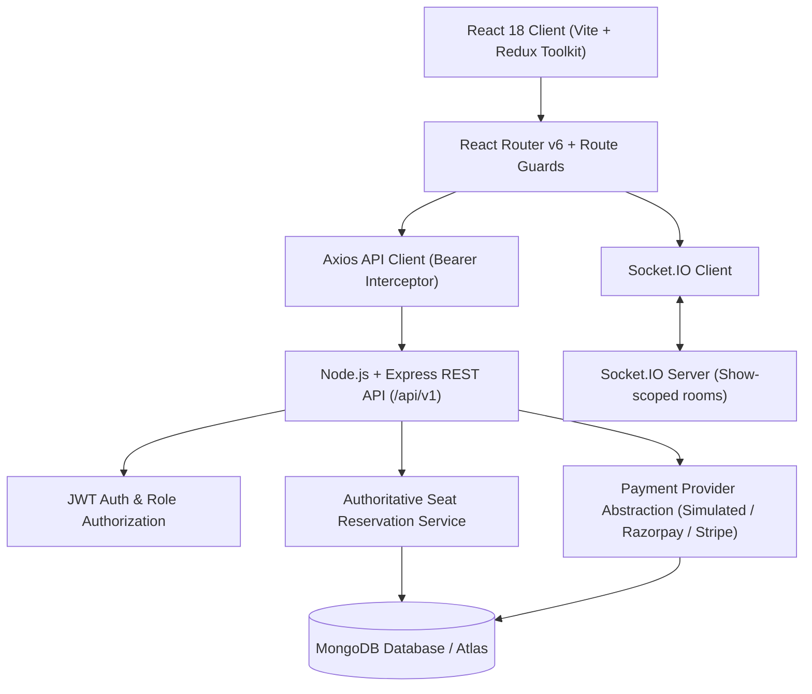
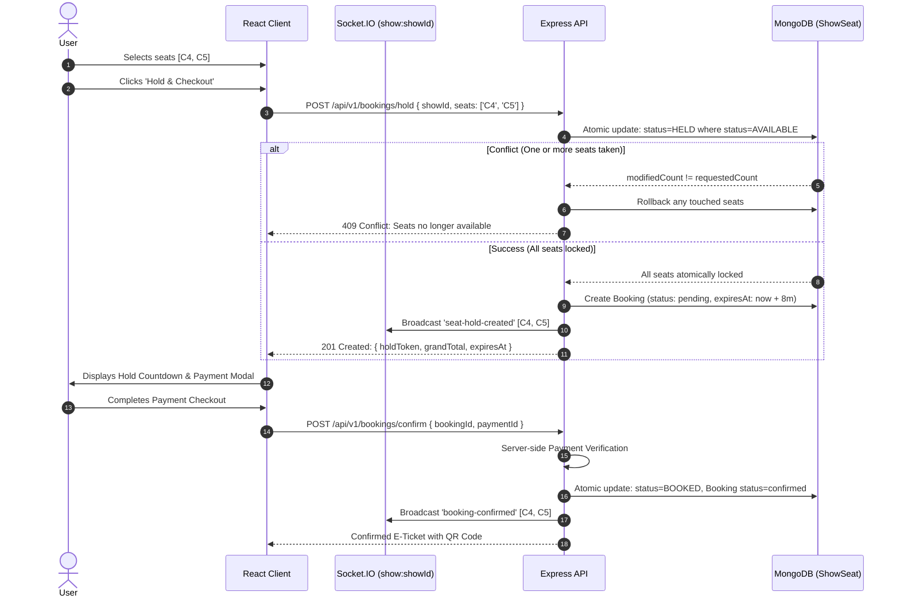

# IMovies — System Architecture & Design Documentation

## 1. System Overview

**IMovies** is an enterprise-grade full-stack cinema management and online movie ticket booking platform built on the MERN stack (MongoDB, Express, React, Node.js) with real-time WebSocket availability updates.

The application follows a **modular client-server monorepo architecture** that isolates the frontend presentation layer from authoritative backend business logic, payment abstractions, and concurrency-controlled database models.

---

## 2. Monorepo Architecture

```
imovies/
├── client/                     # Frontend Application (React 18 + Vite)
│   ├── public/                 # Static public assets
│   ├── src/
│   │   ├── assets/             # Images and design assets
│   │   ├── components/         # Reusable modular components
│   │   │   ├── common/         # Navbar, Footer, ProtectedRoute, ErrorBoundary
│   │   │   ├── movies/         # MovieCard, MovieFilter, TrailerModal
│   │   │   ├── booking/        # SeatGrid, SeatLegend, HoldCountdown, PaymentModal
│   │   │   └── admin/          # AdminSidebar, StatCard, MovieModal, ShowModal
│   │   ├── layouts/            # MainLayout and AdminLayout
│   │   ├── pages/              # Public, Customer, and Admin pages
│   │   ├── services/           # Axios HTTP API services and Socket.IO client
│   │   ├── store/              # Redux Toolkit store (authSlice, bookingSlice)
│   │   ├── styles/             # Cinematic CSS custom design tokens
│   │   ├── App.jsx             # React Router routing & route guards
│   │   └── main.jsx            # Application bootstrap
│   ├── package.json
│   └── vite.config.js
├── server/                     # Backend API & Real-Time Engine (Node + Express)
│   ├── src/
│   │   ├── config/             # DB connection & environment schema validation
│   │   ├── controllers/        # Express request/response controllers
│   │   ├── middleware/         # Auth, Role guard, Upload, Error handler, Rate limit
│   │   ├── models/             # Mongoose schemas (User, Movie, Theatre, Screen, Show, ShowSeat, Booking, Payment, Notification)
│   │   ├── routes/             # REST endpoints under /api/v1
│   │   ├── services/           # SeatReservationService, PaymentService
│   │   ├── sockets/            # Socket.IO room management & event broadcasting
│   │   ├── jobs/               # Background scheduled hold expiration worker
│   │   ├── utils/              # Structured logger, API response helpers, constants
│   │   ├── app.js              # Express app configuration
│   │   └── server.js           # HTTP and WebSocket server initialization
│   ├── tests/                  # Integration test suites (Auth, SeatReservation)
│   ├── uploads/                # Safe media upload directory
│   └── package.json
├── docs/                       # Technical documentation
├── postman/                    # Postman Collection
├── package.json                # Root monorepo orchestrator
├── README.md                   # Setup guide and instructions
└── PROJECT_REPORT.md           # Master Project Report
```

---

## 3. High-Level Architecture Diagram



---

## 4. Real-Time Seat Reservation Engine

The primary architectural challenge in cinema ticketing is preventing **race conditions** and **double bookings** while offering a responsive, live seating map.

### 4.1 State Machine
Every seat in an auditorium for a specific scheduled show exists in one of four states:
1. `AVAILABLE`: Open for selection.
2. `HELD`: Temporarily locked by a user with an active countdown timer (8-minute window).
3. `BOOKED`: Confirmed purchase backed by verified payment.
4. `BLOCKED`: Administratively held for maintenance or accessibility.

### 4.2 Sequence Workflow



---

## 5. Payment Provider Abstraction Layer

The payment system follows an **Adapter Pattern** through `paymentService.js`:
- **Simulator Mode**: Designed for local development and testing. Generates non-forgeable transaction IDs (`SIM_PAY_...`), accepts test checkout options, and supports simulated failure toggling.
- **Razorpay Mode**: Seamless integration with Razorpay Orders API and server-side HMAC-SHA256 signature verification.
- **Stripe Mode**: Compatible with Stripe PaymentIntents.
