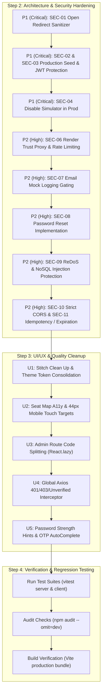

# Security, Architectural & UI/UX Audit Report: IMovies Platform

**Date**: October 23, 2026  
**Auditor**: Senior Full-Stack & Application Security Engineer, UI/UX Designer  
**Repository**: IMovies MERN Monorepo (`client/` React 18 + Vite, `server/` Express 4 + Mongoose 8 + Socket.IO)  
**Deployment Target**: Cloudflare Workers Static Assets (`client/dist` via `wrangler.jsonc`), Render Web Service (`server/`), MongoDB Atlas  
**Audit Branch**: `audit/hardening`  
**Status**: Step 1 Completed (Read-Only Audit Phase). Awaiting User Authorization to Implement.

---

## 1. Executive Summary

A comprehensive, defense-in-depth security, architectural, and UI/UX audit was conducted across the IMovies full-stack cinema management platform. While the core booking engine demonstrates thoughtful architectural patterns (such as server-side price calculation and atomic conditional seat locking), critical security gaps, dependency vulnerabilities, configuration weaknesses, and UI/UX leftovers from Google Stitch were identified.

### Summary of Findings by Severity
| Severity | Count | Primary Impact Areas |
| :--- | :---: | :--- |
| **Critical** | 5 | Open redirect in login flow; automatic admin credential seeding in production; weak JWT secret defaults; unrestricted simulated payment provider in production; dev dependency RCE/prototype pollution. |
| **High** | 7 | Missing Express `trust proxy` setting on Render; dev mock OTP/verification link leaked to production logs; missing password reset mechanism; ReDoS & NoSQL injection vectors in movie search; overly permissive CORS wildcard; payment confirmation missing idempotency key and expiration checks; 10MB excessive JSON body parser limit. |
| **Medium** | 10 | 6-character password policy; non-constant-time OTP comparison & timing user enumeration; unvalidated YouTube iframe embed source; `mongodb-memory-server` in production dependencies; missing input validation on admin & booking endpoints; IP-only rate limiting on auth; missing webhook implementations; localStorage JWT storage without CSRF protection in cookie fallback; unprotected static uploads & deprecated Multer; unvalidated Socket.IO event inputs. |
| **Low / UX** | 4 | Incomplete Axios interceptor error handling for unverified users; 584 kB un-split initial client bundle; seat grid accessibility & touch-target size below 44px; Stitch inline style leftovers & stray console logs. |
| **Total** | **26** | **All findings categorized with reproduction steps and concrete fixes below.** |

---

## 2. Docs vs. Reality & Automated Suite Execution

### 2.1 The Test Count Discrepancy
- **README Claim**: 34 automated tests passing (100%).
- **`PROJECT_REPORT.md` Section 13 Claim**: Lists only 16 tests (5 auth, 4 seat reservation, 5 bookingSlice, 1 SeatLegend, 1 MovieCard).
- **Audit Ground Truth**:
  - The actual test suites pass **34 out of 34 tests** (25 server tests + 9 client tests).
  - The discrepancy in `PROJECT_REPORT.md` occurred because Section 13 was written before the email verification test suites (`emailVerification.test.js` with 15 tests, `VerifyEmailPage.test.jsx` with 2 tests, and 1 additional test in `auth.test.js`) were implemented. The report was never synchronized with the expanded test suites.

### 2.2 Live Test Suite Execution Results

#### Backend Test Suite (`npm run test:server`)
```text
> imovies-monorepo@1.0.0 test:server
> npm run test --prefix server

> imovies-server@1.0.0 test
> vitest run

 RUN  v2.1.9 C:/Users/nayan/OneDrive/Desktop/WEB COURESE/4_th/IMovie-SkillWallet/server

 ✓ tests/seatReservation.test.js (4 tests) 6349ms
 ✓ tests/auth.test.js (6 tests) 6705ms
 ✓ tests/emailVerification.test.js (15 tests) 6816ms

 Test Files  3 passed (3)
      Tests  25 passed (25)
   Duration  10.45s
```

#### Frontend Test Suite (`npm run test:client`)
```text
> imovies-monorepo@1.0.0 test:client
> npm run test --prefix client

> imovies-client@1.0.0 test
> vitest run

 RUN  v2.1.9 C:/Users/nayan/OneDrive/Desktop/WEB COURESE/4_th/IMovie-SkillWallet/client

 ✓ src/test/bookingSlice.test.js (5 tests) 12ms
 ✓ src/test/SeatLegend.test.jsx (1 test) 44ms
 ✓ src/test/MovieCard.test.jsx (1 test) 68ms
 ✓ src/test/VerifyEmailPage.test.jsx (2 tests) 168ms

 Test Files  4 passed (4)
      Tests  9 passed (9)
   Duration  2.59s
```

#### Production Client Build (`npm run build`)
```text
> imovies-monorepo@1.0.0 build
> npm run build --prefix client

> imovies-client@1.0.0 build
> vite build

vite v5.4.21 building for production...
transforming...
✓ 1711 modules transformed.
rendering chunks...
computing gzip size...
dist/index.html                   1.47 kB │ gzip:   0.79 kB
dist/assets/index-DNep4taC.css  253.23 kB │ gzip:  35.57 kB
dist/assets/index-paiU1OkV.js   584.81 kB │ gzip: 169.45 kB

(!) Some chunks are larger than 500 kB after minification. Consider:
- Using dynamic import() to code-split the application
- Use build.rollupOptions.output.manualChunks to improve chunking
✓ built in 3.55s
```
*Observation: The single JS chunk is 584.81 kB because all 6 admin pages are eagerly imported into `App.jsx`.*

---

## 3. Dependency Vulnerability Analysis (`npm audit`)

### 3.1 Production Dependencies Audit (`npm audit --omit=dev`)
```text
# npm audit report

react-router  6.0.0 - 7.17.0
Severity: moderate
React Router: Open redirect via backslash in <Link> and useNavigate (CVE-2025-68470 bypass) - https://github.com/advisories/GHSA-wrjc-x8rr-h8h6
React Router: Arbitrary Constructor Injection via deserializeErrors() in React Router SSR Hydration - https://github.com/advisories/GHSA-337j-9hxr-rhxg
fix available via `npm audit fix --force`
Will install react-router-dom@7.18.4, which is a breaking change
node_modules/react-router
  react-router-dom  6.0.0-alpha.0 - 7.17.0

2 moderate severity vulnerabilities
```

### 3.2 Full Audit (Including Dev Dependencies)
```text
11 vulnerabilities (5 moderate, 4 high, 2 critical)
- tinypool <= 2.1.1 (CRITICAL): Prototype Pollution leading to Remote Code Execution (GHSA-5gmw-xhrv-c9v3, GHSA-85c8-ppgw-ccpr)
- @vitest/mocker <= 4.1.11 (MODERATE): Path Traversal / Arbitrary File Read (GHSA-82fw-gwwq-j7x9, GHSA-qxg6-89mg-rqv8)
- esbuild <= 0.24.2 (MODERATE): Local dev server request vulnerability (GHSA-67mh-4wv8-2f99)
- braces * (HIGH): Stack-exhaustion denial of service through deeply nested patterns via nodemon/chokidar (GHSA-vfj7-8cjw-p6xm)
- react-router 6.0.0 - 7.17.0 (MODERATE): Open redirect & constructor injection (GHSA-wrjc-x8rr-h8h6)
```

### 3.3 Multer Review
- **Current**: `multer@^1.4.5-lts.1` in `server/package.json`.
- **Finding**: Multer 1.x is in maintenance mode and relies on legacy busboy internals. Upgrading to a modern, supported file upload pattern or `multer@2.x` (or adding strict file signature/magic byte verification and extension whitelisting) is required.

---

## 4. Repository Hygiene & Git Secret Audit

1. **Tracked Files Check**:
   - Executed: `git ls-files | grep -E "\.env|uploads|dist"`
   - Output:
     - `client/.env.example` (Safe template)
     - `server/.env.example` (Safe template)
     - `server/uploads/.gitkeep` (Safe placeholder)
   - Confirmed: No active `.env`, `.env.production`, uploaded media, or `dist/` folders are tracked in git.
2. **Git Commit History Secret Search**:
   - Executed full commit history diff inspection for `MONGODB_URI`, `JWT`, `SECRET`, `PASSWORD`.
   - Result: All 7 commits in history only touched `.env.example` templates with placeholder dummy values (`Admin@123456`, `your_email@gmail.com`). No production credentials were ever committed to Git history.
3. **`.gitignore` File Verification**:
   - Confirmed `.gitignore` is correctly named in root, `client/.gitignore`, and `server/.gitignore`. All properly exclude `.env*`, `dist/`, `node_modules/`, `coverage/`, and `server/uploads/*` (preserving `.gitkeep`).

---

## 5. Detailed Security Findings

### SEC-01 [CRITICAL]: Unvalidated Open Redirect in Authentication Flow
- **Category**: Authentication & Authorization
- **Location**: [`client/src/pages/LoginPage.jsx:20, 29`](file:///client/src/pages/LoginPage.jsx#L20-L29)
- **Defect**: The login page retrieves the `redirect` query parameter from the URL (`queryParams.get('redirect') || '/'`) and passes it directly into React Router's `navigate(redirect)` without validating whether it is a safe, relative path on the same origin.
- **Exploit / Reproduction**:
  1. An attacker crafts a link: `https://imovies.pages.dev/login?redirect=https://evil-phishing.com` or `https://imovies.pages.dev/login?redirect=//evil-phishing.com` or `https://imovies.pages.dev/login?redirect=/\evil-phishing.com`.
  2. The victim clicks the link, sees a legitimate IMovies login page, enters credentials, and logs in successfully.
  3. `navigate(redirect)` redirects the victim off-site to `evil-phishing.com` for credential harvesting or session hijacking.
- **Remediation**:
  Implement a strict redirect sanitizer utility `getSafeRedirectUrl(target, fallback = '/')`:
  - Must start with a single `/`.
  - Must NOT start with `//` or `/\`.
  - Must not contain any protocol scheme (`http:`, `https:`, `javascript:`, `data:`).
  - Return `fallback` if the target is invalid or external.

---

### SEC-02 [CRITICAL]: Automatic Seeding of Default Administrator Credentials in Production
- **Category**: Credentials & Production Operations
- **Location**: [`server/src/server.js:33-36`](file:///server/src/server.js#L33-L36), [`server/src/scripts/seed.js:20-65`](file:///server/src/scripts/seed.js#L20-L65), [`server/src/scripts/createAdmin.js:12-50`](file:///server/src/scripts/createAdmin.js#L12-L50)
- **Defect**:
  1. In `server.js`, if the database has zero active theatres on cold start, it automatically calls `seedDatabase({ reset: false, closeConnection: false })` **without checking `NODE_ENV`**.
  2. `seed.js` creates users with hardcoded default credentials: `admin@imovies.com` / `Admin@123456` and `john@example.com` / `User@123456`.
  3. Neither `npm run seed` nor `npm run seed:admin` blocks execution in `NODE_ENV === 'production'`.
- **Exploit / Reproduction**:
  1. When deploying a fresh MongoDB Atlas instance on Render with `NODE_ENV=production`, the server detects 0 theatres on startup.
  2. It automatically seeds `admin@imovies.com` with `Admin@123456`.
  3. Any attacker reading the README can log into the production admin dashboard, view all customer bookings, modify ticket prices, and refund arbitrary payments.
- **Remediation**:
  1. In `server.js`: Remove automatic seeding in production. Auto-seeding should ONLY be permitted if `NODE_ENV === 'development'`.
  2. In `seed.js` and `createAdmin.js`: Refuse to execute if `NODE_ENV === 'production'` unless `ADMIN_SEED_PASSWORD` is explicitly provided via environment variables with a minimum 14-character entropy requirement and no fallback default.

---

### SEC-03 [CRITICAL]: Insecure JWT Secret Validation & Missing Algorithm Pinning
- **Category**: Cryptography & Session Management
- **Location**: [`server/src/config/environment.js:4-10, 17`](file:///server/src/config/environment.js#L4-L17), [`server/src/utils/token.js:17-25`](file:///server/src/utils/token.js#L17-L25)
- **Defect**:
  1. `environment.js` only checks if `process.env.JWT_ACCESS_SECRET` is truthy in production. If the user set it to the sample value `'imovies_super_secret_jwt_access_token_key_change_in_production_2026'` or any short string, startup succeeds.
  2. In `token.js`, `jwt.verify(token, env.JWT_ACCESS_SECRET)` does not specify `{ algorithms: ['HS256'] }`.
- **Exploit / Reproduction**:
  1. If an operator copies `.env.example` directly to Render, the server starts using the public sample key from GitHub.
  2. An attacker crafts a forged JWT with `{ id: "target-user-id", role: "admin" }` signed with the public sample key and gains full administrator access.
  3. If an attacker submits a JWT signed with algorithm `none` or an asymmetric key substitution, `jwt.verify` without pinned algorithms could allow signature bypass.
- **Remediation**:
  1. Enforce on server startup:
     ```javascript
     if (env.NODE_ENV === 'production') {
       if (!env.JWT_ACCESS_SECRET || env.JWT_ACCESS_SECRET.length < 32 || env.JWT_ACCESS_SECRET.includes('change_in_production')) {
         throw new Error('FATAL: JWT_ACCESS_SECRET must be at least 32 characters and cannot match default sample.');
       }
     }
     ```
  2. Explicitly pin `algorithm: 'HS256'` in `jwt.sign` and `algorithms: ['HS256']` in `jwt.verify`.

---

### SEC-04 [CRITICAL]: Payment Simulator Enabled in Production Without Safeguard
- **Category**: Financial & Booking Integrity
- **Location**: [`server/src/config/environment.js:20`](file:///server/src/config/environment.js#L20), [`server/src/services/paymentService.js:8-23`](file:///server/src/services/paymentService.js#L8-L23)
- **Defect**: `PAYMENT_PROVIDER` defaults to `'simulated'`. Startup never validates that `PAYMENT_PROVIDER !== 'simulated'` when `NODE_ENV === 'production'`.
- **Exploit / Reproduction**:
  1. Deploy to Render with `NODE_ENV=production` without setting `PAYMENT_PROVIDER=razorpay`.
  2. Users can book real cinema seats for free by submitting mock simulator orders, resulting in total revenue loss.
- **Remediation**:
  1. In `environment.js`: Throw a fatal error on startup if `NODE_ENV === 'production'` and `PAYMENT_PROVIDER === 'simulated'`.
  2. In `paymentController.js`: Reject `/api/v1/payments/simulate` with 403 Forbidden if `NODE_ENV === 'production'`.

---

### SEC-05 [CRITICAL]: Dev Dependency Remote Code Execution via Prototype Pollution in Vitest / Tinypool
- **Category**: Supply Chain Vulnerability
- **Location**: `package-lock.json`, `node_modules/tinypool` (GHSA-5gmw-xhrv-c9v3, GHSA-85c8-ppgw-ccpr)
- **Defect**: Tinypool <= 2.1.1 has a prototype pollution gadget in worker thread options that can escalate to arbitrary command execution when malicious configuration objects are processed during test runs.
- **Remediation**:
  Update `vitest` to version `^2.1.9` / `^3.x` and resolve `tinypool` to patched release >= 2.1.2 without running blind `npm audit fix --force`.

---

### SEC-06 [HIGH]: Missing Express `trust proxy` Setting on Reverse Proxy (Render)
- **Category**: Rate Limiting & Network Security
- **Location**: [`server/src/app.js:19-21`](file:///server/src/app.js#L19-L21), [`server/src/middleware/rateLimiter.js`](file:///server/src/middleware/rateLimiter.js)
- **Defect**: Express is mounted without `app.set('trust proxy', 1)`. In Render (and Cloudflare), requests arrive through reverse proxies that append the actual client IP to `X-Forwarded-For`.
- **Exploit / Reproduction**:
  1. `req.ip` resolves to Render's internal reverse proxy IP for all incoming traffic.
  2. `express-rate-limit` counts requests against the single proxy IP. If 30 legitimate users log in within 15 minutes, the 31st user globally receives a 429 Too Many Requests lockout.
  3. Conversely, if rate limiters fail to extract the real IP, distributed brute-force attacks proceed unrestricted.
- **Remediation**:
  In `app.js`, add:
  ```javascript
  if (env.NODE_ENV === 'production' || process.env.RENDER) {
    app.set('trust proxy', 1);
  }
  ```

---

### SEC-07 [HIGH]: Sensitive OTP & Verification Links Leaked to Production Logs
- **Category**: Information Disclosure & Secret Leakage
- **Location**: [`server/src/services/emailService.js:137-142`](file:///server/src/services/emailService.js#L137-L142)
- **Defect**: When SMTP credentials are not configured or SMTP fails, `emailService` enters mock mode (`this.isMock = true`). When sending emails, it logs the recipient's 6-digit OTP and plaintext verification URL directly to `logger.info` regardless of `NODE_ENV`.
- **Exploit / Reproduction**:
  1. An operator forgets SMTP credentials on staging or production.
  2. A user signs up. The OTP and direct verification token are output to stdout/stderr.
  3. Anyone with access to log viewers (Render logs, Datadog, log drains, terminal sessions) can hijack accounts without possessing the user's email.
- **Remediation**:
  Strictly condition mock logging to `NODE_ENV === 'development'`. In all other environments, log only that mock mode was utilized (masking tokens and OTPs entirely).

---

### SEC-08 [HIGH]: Missing Password Reset Implementation
- **Category**: Account Recovery & Integrity
- **Location**: [`server/src/models/User.js:44-45`](file:///server/src/models/User.js#L44-L45), [`server/src/routes/authRoutes.js`](file:///server/src/routes/authRoutes.js)
- **Defect**: The `User` model reserves `passwordResetToken` and `passwordResetExpires`, but no routes, validators, or controller logic exist for `/forgot-password` or `/reset-password`.
- **Exploit / Impact**:
  Users who forget their passwords have zero account recovery mechanism. Any manual DB edits by admins risk compromising password hash integrity or violating audit standards.
- **Remediation**:
  Implement full password reset workflow:
  1. `POST /api/v1/auth/forgot-password`: Rate-limited, generates 32-byte crypto token, stores SHA-256 hash in DB with 15-minute expiry, sends email, returns generic success response (no email enumeration).
  2. `POST /api/v1/auth/reset-password`: Validates token hash, validates password policy (>= 10 chars), updates `passwordHash` (bcrypt salt 12), invalidates existing sessions.

---

### SEC-09 [HIGH]: ReDoS & NoSQL Query Injection in Movie Catalog Search
- **Category**: Input Validation & Denial of Service
- **Location**: [`server/src/controllers/movieController.js:23, 27, 31-37`](file:///server/src/controllers/movieController.js#L23-L37)
- **Defect**:
  1. `new RegExp(search.trim(), 'i')`, `new RegExp(genre, 'i')`, and `new RegExp(language, 'i')` construct regex objects directly from user-supplied query parameters without escaping special regex characters.
  2. No NoSQL operator sanitization (`express-mongo-sanitize`) is configured in Express.
- **Exploit / Reproduction**:
  1. An attacker submits `GET /api/v1/movies?search=((a+)+)+$` or similar ReDoS patterns.
  2. The Node.js event loop freezes during catastrophic regex backtracking, causing a Denial of Service for all concurrent cinema bookings.
  3. Passing query objects like `GET /api/v1/movies?genre[$ne]=all` can manipulate underlying MongoDB filtering.
- **Remediation**:
  1. Escape regex input using `search.replace(/[.*+?^${}()|[\]\\]/g, '\\$&')`.
  2. Add `express-mongo-sanitize` middleware in `app.js`.
  3. Validate query parameter types in `express-validator` (reject non-strings).

---

### SEC-10 [HIGH]: Overly Permissive CORS Policy Allowing All Cloudflare Pages Wildcards
- **Category**: Cross-Origin Security
- **Location**: [`server/src/config/cors.js:26-34`](file:///server/src/config/cors.js#L26-L34)
- **Defect**:
  `isOriginAllowed` checks `if (parsed.hostname.endsWith('.pages.dev')) return true;` alongside `credentials: true`.
- **Exploit / Reproduction**:
  Any threat actor can register a free Cloudflare Pages project (e.g. `malicious-attacker.pages.dev`). When an authenticated IMovies user visits that site, the attacker's script can make authenticated requests with cookies to `/api/v1/bookings/my` or `/api/v1/users/me` and read private booking data.
- **Remediation**:
  Remove the wildcard `endsWith('.pages.dev')`. Only permit explicitly whitelisted origins loaded from `CORS_ORIGINS` or `CLIENT_URL` environment variables.

---

### SEC-11 [HIGH]: Missing Idempotency Key & Expired Hold Bypasses in Payment Confirmation
- **Category**: Concurrency & Payment Verification
- **Location**: [`server/src/controllers/bookingController.js:71-100`](file:///server/src/controllers/bookingController.js#L71-L100), [`server/src/services/seatReservationService.js:283-314`](file:///server/src/services/seatReservationService.js#L283-L314)
- **Defect**:
  1. `confirmBooking` in `bookingController.js` does not verify `booking.expiresAt > new Date()` before verifying payment. If a hold expired 30 seconds ago but the 15-second background cleanup hasn't run, `confirmBookingPayment` will still find `status: SEAT_STATUS.HELD` and confirm the booking.
  2. `confirmBooking` has no `Idempotency-Key` tracking. Duplicate requests during network spikes or double clicks can trigger redundant payment logging or conflicting race conditions.
  3. Payment amount verification is not performed against the authoritative booking grand total.
- **Remediation**:
  1. In `confirmBooking`, reject immediately if `new Date(booking.expiresAt) < new Date()`.
  2. Validate that `payload.amount` matches `booking.grandTotal`.
  3. Support `Idempotency-Key` header and store idempotent payment attempts.

---

### SEC-12 [HIGH]: Excessive Request Body Size Limit (10MB)
- **Category**: Resource Exhaustion & DoS
- **Location**: [`server/src/app.js:32-33`](file:///server/src/app.js#L32-L33)
- **Defect**: `express.json({ limit: '10mb' })` and `express.urlencoded({ limit: '10mb' })` are configured for standard API JSON endpoints.
- **Exploit / Reproduction**:
  An attacker posts 10MB JSON strings to `/api/v1/auth/login` or `/api/v1/bookings/hold`. Parsing multi-megabyte payloads in Node's V8 engine spikes memory usage and locks the main thread.
- **Remediation**:
  Set JSON body limits to `100kb` for standard API routes. File uploads are already handled separately via Multer streaming.

---

### SEC-13 [MEDIUM]: Weak Password Policy & Sub-Standard Bcrypt Cost
- **Category**: Authentication & Credential Storage
- **Location**: [`server/src/validators/authValidator.js:21`](file:///server/src/validators/authValidator.js#L21), [`client/src/pages/RegisterPage.jsx:33`](file:///client/src/pages/RegisterPage.jsx#L33), [`server/src/controllers/authController.js:21`](file:///server/src/controllers/authController.js#L21), [`server/src/scripts/seed.js:42`](file:///server/src/scripts/seed.js#L42)
- **Defect**:
  1. Password minimum is only 6 characters.
  2. Bcrypt cost is set to salt rounds 10 (`bcrypt.genSalt(10)`).
- **Remediation**:
  1. Raise password minimum to at least 10 characters (with lowercase, uppercase, and digit/special character).
  2. Increase bcrypt cost to 12 rounds (`bcrypt.genSalt(12)`).

---

### SEC-14 [MEDIUM]: Non-Constant-Time OTP Compare & User Timing Enumeration
- **Category**: Timing Attacks & Cryptography
- **Location**: [`server/src/controllers/authController.js:148, 254-266`](file:///server/src/controllers/authController.js#L148-L266)
- **Defect**:
  1. `user.emailVerificationOtpHash !== submittedOtpHash` uses standard JavaScript string equality rather than `crypto.timingSafeEqual`.
  2. In `login`: If the user is not found, it returns immediately in ~5ms. If the user exists, `user.comparePassword` executes in ~250ms.
- **Exploit / Reproduction**:
  Measuring HTTP response latency allows an attacker to enumerate whether an email exists in the database.
- **Remediation**:
  1. Use `crypto.timingSafeEqual(Buffer.from(a), Buffer.from(b))` for hashes.
  2. Execute a dummy bcrypt comparison when the user is not found to normalize response timing.

---

### SEC-15 [MEDIUM]: Arbitrary External Iframe Embedding in Trailer Modal
- **Category**: UI Redirection & Clickjacking
- **Location**: [`client/src/components/movies/TrailerModal.jsx:8-15, 30-35`](file:///client/src/components/movies/TrailerModal.jsx#L8-L35)
- **Defect**: If `trailerUrl` does not match YouTube patterns, `embedUrl` remains whatever raw string was stored in the movie document. This is passed directly into `<iframe src={embedUrl} />`.
- **Exploit / Reproduction**:
  If a movie contains an arbitrary URL (or an admin account is compromised), users opening trailer previews are served third-party sites inside an iframe.
- **Remediation**:
  Strictly restrict `embedUrl` to `https://www.youtube.com/embed/<videoId>` or `https://www.youtube-nocookie.com/embed/<videoId>`. If the URL cannot be parsed into a valid YouTube video ID, render a safe placeholder.

---

### SEC-16 [MEDIUM]: `mongodb-memory-server` in Production Dependencies
- **Category**: Dependency Architecture
- **Location**: [`server/package.json:26`](file:///server/package.json#L26), [`server/src/config/db.js:27`](file:///server/src/config/db.js#L27)
- **Defect**: `mongodb-memory-server` is placed under `"dependencies"`.
- **Impact**: Bloats production container images, downloads platform-specific MongoDB binaries during cloud deployments, and risks accidental fallback in misconfigured production containers.
- **Remediation**:
  Move `mongodb-memory-server` to `"devDependencies"`. In `db.js`, fail fast if `NODE_ENV === 'production'` without attempting embedded fallback.

---

### SEC-17 [MEDIUM]: Missing Input Validation on Booking & Admin Routes
- **Category**: Input Validation
- **Location**: [`server/src/routes/bookingRoutes.js`](file:///server/src/routes/bookingRoutes.js), [`server/src/routes/movieRoutes.js`](file:///server/src/routes/movieRoutes.js), [`server/src/routes/theatreRoutes.js`](file:///server/src/routes/theatreRoutes.js), [`server/src/routes/showRoutes.js`](file:///server/src/routes/showRoutes.js)
- **Defect**: Routes such as `/bookings/hold`, `/bookings/create-order`, `/bookings/confirm`, `/bookings/:id`, and `/movies/:id` do not run `express-validator` middleware to check Mongo ObjectIds or payload schemas.
- **Remediation**:
  Add explicit validators using `param('id').isMongoId()` and body validators for all mutation routes.

---

### SEC-18 [MEDIUM]: Missing Account-Based Authentication Rate Limiting
- **Category**: Brute-Force Protection
- **Location**: [`server/src/middleware/rateLimiter.js:3-13`](file:///server/src/middleware/rateLimiter.js#L3-L13)
- **Defect**: `authLimiter` limits requests exclusively by `req.ip` (30 requests / 15 min).
- **Remediation**:
  Add dual-key rate limiting (per IP and per normalized email address) using `express-rate-limit` key generators.

---

### SEC-19 [MEDIUM]: Missing Webhook Handlers for Payment Gateways
- **Category**: Payment Infrastructure
- **Location**: [`server/.env.example:23, 27`](file:///server/.env.example#L23-L27), [`server/src/routes/paymentRoutes.js`](file:///server/src/routes/paymentRoutes.js)
- **Defect**: Razorpay and Stripe webhook endpoints are absent despite webhook secrets being referenced in `.env.example`.
- **Remediation**:
  Implement `/api/v1/payments/webhook` with raw-body HMAC signature validation and replay protection.

---

### SEC-20 [MEDIUM]: JWTs in `localStorage` Without CSRF Protection for Cookie Mode
- **Category**: Session Storage & CSRF
- **Location**: [`client/src/services/api.js:23-30`](file:///client/src/services/api.js#L23-L30), [`server/src/controllers/authController.js:284-289`](file:///server/src/controllers/authController.js#L284-L289)
- **Defect**: The client stores the JWT in `localStorage` (susceptible to XSS). Concurrently, the backend issues an `httpOnly; sameSite: 'none'` cookie for cross-origin requests without a CSRF anti-forgery header check.
- **Remediation**:
  Enforce a custom header (e.g. `X-Requested-With: XMLHttpRequest` or `X-IMovies-Client: 1`) on all state-changing API routes to prevent browser cross-site request forgery when using cookies.

---

### SEC-21 [MEDIUM]: Unprotected Static Media Uploads & Deprecated Multer
- **Category**: Static File Serving & Upload Security
- **Location**: [`server/src/app.js:42`](file:///server/src/app.js#L42), [`server/src/middleware/upload.js`](file:///server/src/middleware/upload.js)
- **Defect**: Static uploads directory `/uploads` is served with no `Content-Security-Policy` or `X-Content-Type-Options: nosniff`. Multer 1.4.5-lts.1 is deprecated.
- **Remediation**:
  Serve uploads with headers `Content-Disposition: inline`, `X-Content-Type-Options: nosniff`, and a restrictive CSP preventing script execution. Upgrade Multer.

---

### SEC-22 [MEDIUM]: Unvalidated Socket.IO Events & Missing Reconnect Subscription
- **Category**: WebSocket Security & State
- **Location**: [`server/src/sockets/socketHandler.js:27-40`](file:///server/src/sockets/socketHandler.js#L27-L40), [`client/src/pages/SeatSelectionPage.jsx:54-93`](file:///client/src/pages/SeatSelectionPage.jsx#L54-L93)
- **Defect**:
  1. `join-show` does not validate if `showId` is a valid 24-character hex ObjectId before querying.
  2. If the Socket.IO client temporarily disconnects and reconnects, it fails to re-emit `join-show`, leaving the client out of sync with real-time seat locks.
- **Remediation**:
  Validate `showId` format on `join-show`. In `SeatSelectionPage.jsx`, attach a `socket.on('connect')` listener that re-joins the current show room upon reconnection.

---

### SEC-23 [LOW]: Incomplete Axios Error Interception for Unverified Users
- **Category**: UI/UX & Routing
- **Location**: [`client/src/services/api.js:33-51`](file:///client/src/services/api.js#L33-L51)
- **Defect**: The Axios response interceptor does not intercept 403 responses with `code: 'EMAIL_NOT_VERIFIED'`, causing failed booking hold requests to show a generic error toast instead of routing the user to the verification page.
- **Remediation**:
  Intercept `403` with `EMAIL_NOT_VERIFIED` and navigate to `/verify-email?email=<email>`.

---

### SEC-24 [LOW]: Client Bundle Size Exceeding 500 kB (Missing Admin Code Splitting)
- **Category**: Performance & Build Optimization
- **Location**: [`client/src/App.jsx:31-38`](file:///client/src/App.jsx#L31-L38)
- **Defect**: All 6 admin pages are statically bundled in the main bundle chunk (`584.81 kB`).
- **Remediation**:
  Use `React.lazy()` for all admin routes (`AdminDashboardPage`, `AdminMoviesPage`, `AdminTheatresPage`, `AdminShowsPage`, `AdminBookingsPage`, `AdminUsersPage`) wrapped in `<Suspense>`.

---

### SEC-25 [LOW]: Accessibility & Mobile Touch Targets in Seating Grid
- **Category**: Accessibility (WCAG 2.1) & Mobile UX
- **Location**: [`client/src/components/booking/SeatGrid.jsx:55-63`](file:///client/src/components/booking/SeatGrid.jsx#L55-L63), [`client/src/styles/index.css:349`](file:///client/src/styles/index.css#L349)
- **Defect**:
  1. Seat buttons are styled at `36px × 34px`, which violates the standard 44px minimum touch target for mobile devices.
  2. Buttons lack `aria-label` detailing row, seat number, tier, and status.
  3. `HoldCountdown` lacks `aria-live="polite"`.
  4. `confetti()` in `BookingConfirmationPage.jsx` does not respect `prefers-reduced-motion`.
- **Remediation**:
  Expand touch target to 44px on mobile viewports. Add `aria-label`, `aria-pressed`, `aria-live`, and motion preference checks.

---

### SEC-26 [LOW]: Google Stitch Leftover Inline Styles & Stray Console Errors
- **Category**: Code Quality & Cleanliness
- **Location**: [`client/src/pages/HomePage.jsx`](file:///client/src/pages/HomePage.jsx), [`client/src/pages/MovieDetailsPage.jsx`](file:///client/src/pages/MovieDetailsPage.jsx)
- **Defect**: Over 300 instances of verbose inline `style={{ ... }}` objects and unhandled `console.error` statements leftover from Stitch UI generation.
- **Remediation**:
  Extract common cards, badges, and headers into reusable classes in `index.css` and remove unnecessary console statements.

---

## 6. Prioritized Remediation Roadmap



---

## 7. Required Environment Variables Specification

The application requires the following environment variables across deployment environments (names only; no secrets):

### Server (`server/.env`)
- `NODE_ENV`: Runtime mode (`development`, `test`, `production`).
- `PORT`: HTTP port (e.g. `5000` or Render dynamic port).
- `CLIENT_URL`: Trusted frontend origins for CORS and verification links (comma-separated).
- `CORS_ORIGINS`: Explicit CORS whitelist (comma-separated).
- `MONGODB_URI`: MongoDB Atlas connection string (must have least privilege).
- `JWT_ACCESS_SECRET`: Cryptographically strong random key (>= 32 chars).
- `JWT_ACCESS_EXPIRES_IN`: Token validity lifetime (e.g. `15m` with refresh or `24h`).
- `PAYMENT_PROVIDER`: Payment gateway provider (`simulated`, `razorpay`, `stripe`).
- `PAYMENT_TEST_MODE`: Boolean for test/live gateway modes.
- `RAZORPAY_KEY_ID`: Gateway public key.
- `RAZORPAY_KEY_SECRET`: Gateway secret key.
- `PAYMENT_WEBHOOK_SECRET`: Webhook signing secret.
- `SMTP_HOST`: Mail server hostname.
- `SMTP_PORT`: Mail server port (`587` or `465`).
- `SMTP_SECURE`: Boolean for SSL/TLS.
- `SMTP_USER`: SMTP username / email.
- `SMTP_PASS`: SMTP app password / API key.
- `EMAIL_FROM`: Branded sender address.
- `EMAIL_VERIFICATION_TOKEN_TTL_MINUTES`: Expiry for OTP and links.
- `ADMIN_SEED_EMAIL`: Email for production admin creation.
- `ADMIN_SEED_PASSWORD`: High-entropy password for admin creation (required in production).

### Client (`client/.env`)
- `VITE_API_BASE_URL`: Base REST API endpoint (e.g. `https://api.imovies.com/api/v1`).
- `VITE_SOCKET_URL`: Socket.IO endpoint (e.g. `https://api.imovies.com`).
- `VITE_APP_NAME`: Application branding title.
- `VITE_CURRENCY_SYMBOL`: Currency formatting symbol (e.g. `₹`).

---

## 8. Conclusion & Read-Only Audit Sign-Off

This audit report concludes **Step 1 (Read-Only)** on branch `audit/hardening`. No source code modifications, migrations, or dependency updates have been executed.

**Next Step**: Please review this audit report and give your approval ("go") to proceed to **Step 2 (UI/UX Improvements)** and **Step 3 (Implementation, Testing, and Verification)**.
