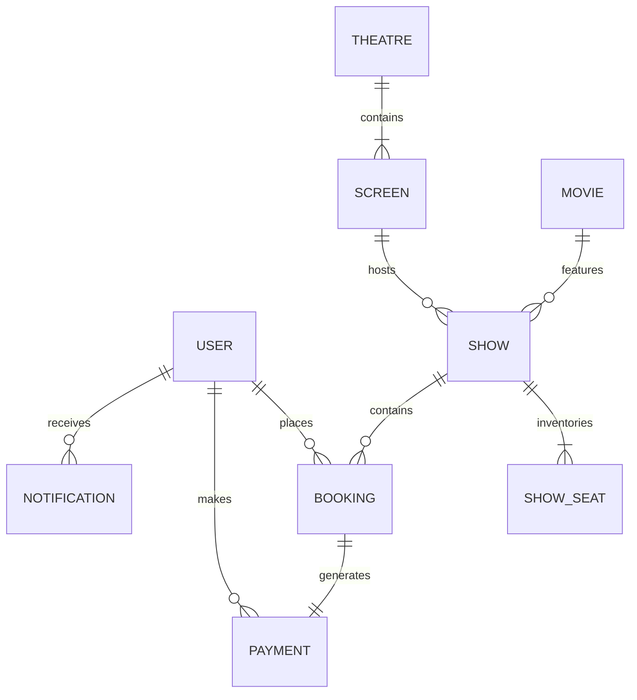

# IMovies — Database Schema & Data Dictionary

This document details the MongoDB schemas, collections, field types, relationships, and indexing strategies implemented in IMovies via Mongoose ODM.

---

## 1. Entity-Relationship (ER) Diagram

---

## 2. Models & Collections

### 2.1 User (`users`)
Stores customer accounts and system administrators.
- `name` (String, required): User's full name.
- `email` (String, required, unique, lowercase, trimmed): Primary login identifier.
- `passwordHash` (String, required): Password hashed with bcryptjs (10 salt rounds).
- `role` (String, enum: `['user', 'admin']`, default: `'user'`).
- `phone` (String, optional): Mobile phone number.
- `avatar` (String, optional): Profile image URL.
- `accountStatus` (String, enum: `['active', 'suspended']`, default: `'active'`).
- `timestamps`: `createdAt`, `updatedAt`.
- **Indexes**: `{ email: 1 }` (unique).

### 2.2 Movie (`movies`)
Catalogue of feature films and metadata.
- `title` (String, required, trimmed): Title of the movie.
- `slug` (String, required, unique, lowercase): SEO-friendly slug.
- `synopsis` (String, required): Overview and storyline.
- `posterUrl` (String, required): Vertical movie poster URL.
- `backdropUrl` (String): Horizontal banner URL.
- `trailerUrl` (String): YouTube embed or watch link.
- `genres` (Array of Strings): e.g. `['Sci-Fi', 'Action']`.
- `languages` (Array of Strings): e.g. `['English', 'Hindi']`.
- `duration` (Number, required): Runtime in minutes.
- `releaseDate` (Date, required): Release date.
- `certification` (String, enum: `['U', 'UA', 'A', 'PG', 'PG-13', 'R']`).
- `director` (String): Director's name.
- `cast` (Array of subdocuments: `{ name, role, avatar }`).
- `rating` (Number, min: 0, max: 10, default: 8.5).
- `status` (String, enum: `['now_showing', 'coming_soon', 'archived']`).
- **Indexes**:
  - Text index: `{ title: 'text', synopsis: 'text', genres: 'text', director: 'text' }`
  - Compound index: `{ status: 1, releaseDate: -1 }`

### 2.3 Theatre (`theatres`)
Physical multiplex or cinema venue.
- `name` (String, required, trimmed): Cinema complex name.
- `slug` (String, required, unique).
- `description` (String): Highlights.
- `address` (String, required): Physical street address.
- `city` (String, required): Metro city (indexed).
- `state` (String).
- `postalCode` (String).
- `country` (String, default: `'India'`).
- `amenities` (Array of Strings): e.g. `['Dolby Atmos', '4K Laser', 'Recliners']`.
- `isActive` (Boolean, default: true).
- **Indexes**: `{ city: 1, isActive: 1 }`.

### 2.4 Screen (`screens`)
Auditoriums within a theatre.
- `theatre` (ObjectId ref Theatre, required).
- `name` (String, required): e.g. `'Audi 1 - IMAX'`.
- `screenType` (String, enum: `['Standard', 'IMAX', '4DX', 'Dolby Atmos', 'Gold Class']`).
- `totalSeats` (Number, required).
- `seatingLayout` (Object):
  - `rows`: Array of `{ rowLetter, category, priceMultiplier, seats: [{ seatNumber, number, isAisle }] }`.
- `isActive` (Boolean, default: true).
- **Indexes**: `{ theatre: 1, name: 1 }` (unique compound index).

### 2.5 Show (`shows`)
Specific screening session.
- `movie` (ObjectId ref Movie, required).
- `theatre` (ObjectId ref Theatre, required).
- `screen` (ObjectId ref Screen, required).
- `startTime` (Date, required): Show start time (UTC).
- `endTime` (Date, required): Show end time (UTC).
- `basePrice` (Number, required, min: 50).
- `seatPricing` (Object): `{ silver: Number, gold: Number, platinum: Number }`.
- `status` (String, enum: `['scheduled', 'running', 'completed', 'cancelled']`).
- **Indexes**:
  - `{ movie: 1, startTime: 1 }`
  - `{ theatre: 1, screen: 1, startTime: 1, endTime: 1 }`

### 2.6 ShowSeat (`showseats`)
Authoritative per-show seat inventory record.
- `show` (ObjectId ref Show, required).
- `seatNumber` (String, required): e.g. `'C4'`.
- `row` (String, required): e.g. `'C'`.
- `number` (Number, required): e.g. `4`.
- `category` (String, enum: `['SILVER', 'GOLD', 'PLATINUM']`).
- `price` (Number, required).
- `status` (String, enum: `['AVAILABLE', 'HELD', 'BOOKED', 'BLOCKED']`).
- `heldBy` (ObjectId ref User, default: null).
- `heldUntil` (Date, default: null).
- `holdToken` (String, default: null).
- `booking` (ObjectId ref Booking, default: null).
- **Indexes**:
  - `{ show: 1, seatNumber: 1 }` (**Unique constraint**: ensures absolute seat uniqueness per show).
  - `{ show: 1, status: 1, heldUntil: 1 }` (Optimizes hold queries and expiration cleanup).

### 2.7 Booking (`bookings`)
Ticket purchase record.
- `bookingReference` (String, required, unique, uppercase): e.g. `'IMV-8K9P2X'`.
- `user` (ObjectId ref User, required).
- `show` (ObjectId ref Show, required).
- `seats` (Array of `{ seatNumber, category, price }`).
- `totalAmount` (Number, required).
- `convenienceFee` (Number, default: 0).
- `grandTotal` (Number, required).
- `status` (String, enum: `['pending', 'confirmed', 'cancelled', 'expired']`).
- `paymentStatus` (String, enum: `['pending', 'success', 'failed', 'refunded']`).
- `paymentReference` (String).
- `holdToken` (String).
- `expiresAt` (Date).
- `qrCode` (String): Base64 data URL.
- `cancellationDetails` (Object: `{ cancelledAt, cancellationReason, refundAmount, refundStatus }`).
- **Indexes**:
  - `{ bookingReference: 1 }` (unique)
  - `{ user: 1, createdAt: -1 }`

### 2.8 Payment (`payments`)
Financial audit log.
- `booking` (ObjectId ref Booking, required).
- `user` (ObjectId ref User, required).
- `amount` (Number, required).
- `currency` (String, default: `'INR'`).
- `provider` (String, enum: `['simulated', 'razorpay', 'stripe']`).
- `providerPaymentId` (String).
- `status` (String, enum: `['pending', 'success', 'failed', 'refunded']`).
- `method` (String: `'card'`, `'upi'`, `'netbanking'`, `'simulator'`).
- `refundId` (String).

### 2.9 Notification (`notifications`)
User alert records.
- `user` (ObjectId ref User, required).
- `type` (String, enum: `['booking_confirmed', 'booking_cancelled', 'hold_expired', 'reminder', 'system']`).
- `title` (String, required).
- `message` (String, required).
- `bookingReference` (String).
- `read` (Boolean, default: false).
- **Indexes**: `{ user: 1, read: 1, createdAt: -1 }`.
