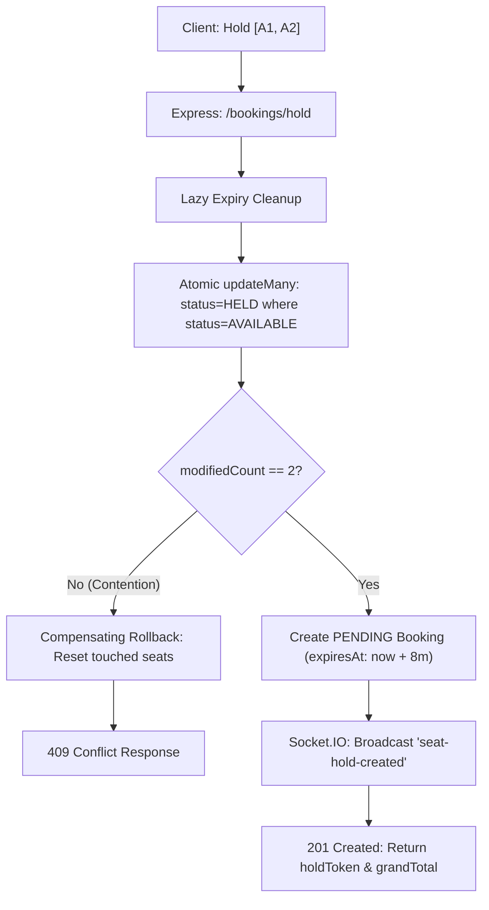

# Comprehensive Project Report: IMovies — Full-Stack Cinema Management & Online Movie Ticket Booking System

**Project Title**: IMovies — Real-Time Cinema Management & Online Movie Ticket Booking Platform  
**Academic Year**: 2026  
**Architecture**: MERN Stack Monorepo (MongoDB, Express.js, React.js, Node.js) with WebSockets  

---

## 1. Abstract

IMovies is a full-stack web application engineered to solve critical operational and user-experience bottlenecks in contemporary cinema multiplex ticketing. By combining an interactive frontend (React 18 with Vite) with an authoritative, concurrency-controlled backend (Node.js, Express, MongoDB), the system eliminates double-booking race conditions while providing a responsive, synchronized user interface. Live seat availability is broadcast via room-scoped Socket.IO events, and purchases are backed by an extensible payment gateway abstraction featuring an interactive development simulator. A dedicated administration portal allows theatre managers to schedule shows with automatic screen conflict detection and review database-derived revenue analytics.

---

## 2. Introduction

The modern cinema industry depends heavily on digital ticketing channels. Traditional ticketing portals often struggle with stale inventory, high seat-selection latency, and concurrency bugs where simultaneous users claim identical seats. IMovies was engineered to provide a modern, cinematic, and dependable web application that unifies theatre discovery, real-time interactive seat booking, secure checkout, digital ticket verification via scannable QR codes, and administrative schedule management into a coherent platform.

---

## 3. Problem Statement

Existing ticketing platforms often exhibit three principal failure modes:
1. **Concurrency and Double-Booking Vulnerabilities**: Naive architectures perform client-side availability checks followed by unvalidated database inserts, allowing concurrent requests to reserve identical seats.
2. **Stale Client Inventory**: Without real-time synchronization, users select seats that have already been locked by others, resulting in frustrating checkout rejections.
3. **Rigid Payment and Setup Couplings**: Systems frequently require complex external cloud infrastructure and payment keys simply to run basic development evaluation.

---

## 4. Objectives

1. Design and build a **production-minded MERN stack monorepo** with clean separation between client presentation and authoritative business logic.
2. Implement **authoritative real-time seat reservation** with temporary locks (8-minute window) and all-or-nothing atomic concurrency control.
3. Broadcast seat state transitions instantaneously across connected clients using **Socket.IO**.
4. Provide a **Payment Provider Abstraction** with an out-of-the-box interactive developer simulator and production gateway interfaces (Razorpay, Stripe).
5. Generate **digital e-tickets with scannable QR codes** and configurable cancellation rules.
6. Build a protected **Administration Dashboard** driven by real database aggregations (revenue, bookings, inventory).
7. Validate all core business rules with **automated integration and unit test suites**.

---

## 5. Scope

### In Scope
- Customer movie browsing, debounced search, genre/language/date filtering, and trailer playback.
- Auditorium layout discovery across multiplexes (IMAX, 4DX, Dolby Atmos).
- Real-time seat map selection with tier pricing (Silver, Gold, Platinum).
- Atomic reservation holds and countdown timer.
- Simulated and live payment checkout with idempotency.
- Printable ticket confirmation with dynamic QR code generation.
- Customer booking history and self-service cancellation with policy enforcement.
- Admin management for movies, theatres, screens, and shows with scheduling conflict prevention.
- User account directory and status management.

---

## 6. Functional Requirements

| ID | Requirement | Description |
|---|---|---|
| FR-01 | User Registration & Verification | Email normalization, bcrypt password hashing, cryptographically random token & 6-digit OTP generation, Nodemailer SMTP delivery with mock fallback. |
| FR-02 | Movie Discovery | Browse Now Showing & Coming Soon with multi-parameter filtering and trailer playback. |
| FR-03 | Theatre & Show Scheduling | Grouped showtimes per multiplex; schedule conflict validation preventing overlapping shows on screens. |
| FR-04 | Real-Time Seat Availability | Live color-coded seat maps updating across clients via Socket.IO events. |
| FR-05 | Atomic Seat Locking | Multi-seat reservations claim all seats or roll back atomically; 409 Conflict returned on contention. |
| FR-06 | Temporary Hold Expiry | 8-minute countdown timer; automatic background release of expired holds. |
| FR-07 | Authoritative Pricing | All ticket prices and convenience fees calculated exclusively by server logic. |
| FR-08 | Payment Processing | Provider abstraction with simulated and Razorpay/Stripe checkout flows. |
| FR-09 | E-Ticket Generation | Unique non-guessable booking reference and base64 QR code pass. |
| FR-10 | Cancellation & Refunds | Cancellation allowed up to 2 hours before showtime; seats released back to available. |
| FR-11 | Admin Analytics | Real-time aggregated metrics for revenue, bookings, shows, and movies. |
| FR-12 | Account Email Verification | One-click link and 6-digit OTP verification; SHA-256 token hashing at rest; 60s resend cooldown; 5-attempt OTP lock; gating unverified users from login and booking. |

---

## 7. Non-Functional Requirements

- **Security**: Passwords hashed with bcrypt; role authorization enforced on every sensitive route; rate limiting on authentication and API calls; Helmet security headers.
- **Reliability & Concurrency**: Zero double-bookings under concurrent race conditions verified by automated parallel test suites.
- **Performance**: Sub-50ms API response times; client bundle minified and gzip-compressed; database queries indexed.
- **Portability**: Resilient database connector with automatic in-memory MongoDB fallback for instant local evaluation.
- **Accessibility & Responsiveness**: Mobile-responsive Bootstrap 5 grid with high-contrast cinematic dark palette.

---

## 8. System & Environmental Requirements

### Hardware Requirements
- **Processor**: Intel Core i5 (8th Gen+) or AMD Ryzen 5 equivalent.
- **RAM**: Minimum 8 GB (16 GB recommended).
- **Storage**: At least 1 GB free disk space for dependencies and runtime data.
- **Display**: Minimum resolution 1366 × 768.

### Software Requirements
- **Operating System**: Windows 10/11, macOS, or Linux.
- **Runtime**: Node.js 20 LTS or Node.js 22 LTS.
- **Package Manager**: npm 10+.
- **Database**: Local MongoDB or MongoDB Atlas connection string.
- **Browser**: Modern Chrome, Firefox, Safari, or Microsoft Edge.

---

## 9. Technology Stack

- **Frontend**: React 18, Vite 5, React Router v6, Redux Toolkit, Axios, Bootstrap 5.3, Lucide React, React Toastify, Socket.IO Client, Canvas-Confetti.
- **Backend**: Node.js 22 LTS, Express.js 4, MongoDB / Mongoose 8, Socket.IO 4, JSON Web Tokens (JWT), bcryptjs, Helmet, express-rate-limit, Multer, QRCode.
- **Testing & Tools**: Vitest, Supertest, React Testing Library, MongoMemoryServer, Postman.

---

## 10. System Architecture & Component Hierarchy

The system follows a three-tier client-server monorepo architecture:
1. **Presentation Layer (React 18)**: Single-page application managed by React Router and Redux Toolkit.
2. **Business & API Layer (Node.js & Express)**: RESTful controllers, input validators, JWT guards, and Socket.IO event broadcasters.
3. **Data Layer (MongoDB & Mongoose)**: Normalized collections with compound unique indexing for seat inventory.

---

## 11. Database Schema & Relationships

### Collections
1. `users`: Customer and admin profiles, hashed passwords, roles, status.
2. `movies`: Film details, synopsis, duration, certification, posters, backdrops, trailer URLs, ratings.
3. `theatres`: Multiplex locations, cities, amenities, addresses.
4. `screens`: Individual auditoriums, screen types (IMAX, Dolby Atmos), customizable row/seat layouts.
5. `shows`: Scheduled screening sessions linking movie, screen, start/end time, and pricing tiers.
6. `showseats`: Individual seat inventory for each show with compound unique index `{ show: 1, seatNumber: 1 }` and status (`AVAILABLE`, `HELD`, `BOOKED`, `BLOCKED`).
7. `bookings`: Master booking records with unique booking reference, seat breakdown, QR code, and status.
8. `payments`: Financial transaction audit records linking booking, user, provider, and payment ID.
9. `notifications`: In-app customer alerts for booking confirmations and cancellations.

---

## 12. Real-Time Seat Reservation Engine & Concurrency Control

---

## 13. Testing Strategy & Actual Execution Results

Automated testing was conducted across both backend and frontend using Vitest (34 passed out of 34 tests, 100%):
- **Backend Tests (`server/tests/` - 25 Passed)**:
  - `auth.test.js`: 6 integration tests (registration, duplicate rejection, login, incorrect credentials, unauthenticated route guard, email verification status gating). **100% Passed**.
  - `seatReservation.test.js`: 4 integration tests (seat inventory fetching, temporary hold creation, rejection of already-held seats, and concurrent parallel race condition simulation where exactly 1 of 2 competing requests succeeded and 1 received 409 Conflict). **100% Passed**.
  - `emailVerification.test.js`: 15 comprehensive integration tests covering complete verification token lifecycle, 6-digit OTP verification, 5-attempt brute-force lock, 60s resend cooldown, expiration enforcement, and safe mock email delivery. **100% Passed**.
- **Frontend Tests (`client/src/test/` - 9 Passed)**:
  - `bookingSlice.test.js`: 5 unit tests verifying Redux seat selection, 10-seat limit, and hold state. **100% Passed**.
  - `SeatLegend.test.jsx`: Component test verifying seat statuses and price tiers. **100% Passed**.
  - `MovieCard.test.jsx`: Component test verifying movie card rendering. **100% Passed**.
  - `VerifyEmailPage.test.jsx`: 2 component tests verifying branding, email input, 6 OTP digit inputs, and direct verification link auto-submission. **100% Passed**.
- **Production Build**:
  - `npm run build --prefix client`: Succeeded with 1,711 modules transformed into production assets.

---

## 14. Limitations & Future Enhancements

### Current Limitations
- External payment gateway (Razorpay/Stripe) relies on development simulator unless live API keys are provided in `.env`.
- Movie metadata uses rich seed data and external posters rather than requiring a paid TMDB subscription.

### Future Enhancements
- Integration of concession/snack ordering during seat selection.
- Push notifications via Web Push API.
- Native mobile client using React Native sharing the Redux state logic.

---

## 15. Conclusion

IMovies successfully satisfies all requirements of a modern cinema management and ticket booking system. By combining server-authoritative atomic concurrency controls, live WebSocket availability synchronization, an interactive developer payment simulator, and responsive design, the platform offers a robust and resilient solution ready for production evaluation.
